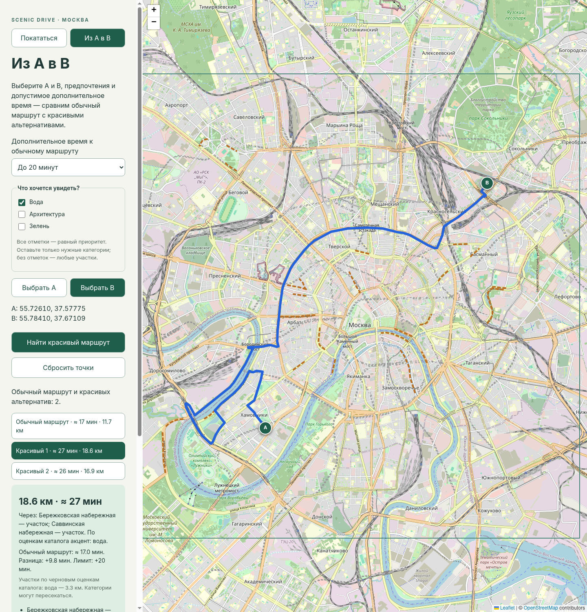

# Scenic Drive

Локальный планировщик автомобильных поездок по центру Москвы на TypeScript/Vite/Leaflet и Python 3.12/FastAPI/OSRM.

Сейчас доступны:

- «Покататься»: старт кликом по карте, 30/45/60/90 минут, до трёх разных поездок через 1–3 дорожных участка с возвращением к старту, линия, расстояние, расчётное время и названия участков.
- «Из A в B»: обычный автомобильный маршрут и до двух разных красивых альтернатив; лимит дополнительного времени 5/10/15/20 минут и те же предпочтения.
- Небольшой локальный GeoJSON-каталог из 27 дорожных линий OSM. На карте они показаны пунктиром. Все записи — **draft**, видимость и оценки красоты из автомобиля ещё не проверены.

Для круговых поездок работают предпочтения (вода, архитектура, зелень), оценка повторных проездов, ранжирование и удаление похожих вариантов. Для A/B альтернативы проверяются по фактическому времени OSRM; если улучшений нет, остаётся обычный маршрут. Нет регистрации, базы данных, LLM или самописной автомобильной маршрутизации.



Снимок работающего приложения с реальным OSRM; карта © OpenStreetMap contributors.

## Docker с внешним OSRM — без подготовки карты

Один контейнер содержит frontend и backend и обращается к внешнему маршрутизатору:

```sh
docker compose -f compose.external.yml up --build --wait --wait-timeout 120
```

Откройте **http://127.0.0.1:8080**. Нужны Docker Engine, Compose 2.20+ и доступ
к интернету. `.env` для первого запуска не требуется. Если соединение требует
прокси, настройте его по [инструкции](docs/docker-external.md); контейнерный localhost
отличается от localhost компьютера.

[Сборка, настройка внешнего OSRM и готовые образы GHCR](docs/docker-external.md).
Публичный demo рассчитан на личное использование, не на многопользовательский сервис.

## Docker с локальным OSRM (необязательно)

Нужны Docker Engine и Docker Compose с поддержкой `up --wait` (Compose 2.20+).
Сначала один раз [подготовьте карту Москвы](docs/osrm.md): extract → partition → customize.
Готовые `.osm.pbf`/`.osrm*` не входят в репозиторий.

Затем из корня:

```sh
docker compose config --quiet
docker compose up --build --wait --wait-timeout 180
```

Откройте **http://127.0.0.1:8080**. В Compose работают nginx со статической сборкой,
backend и локальный OSRM. Внешний demo для маршрутов не используется; интернет
браузеру нужен для тайлов OSM. Публикуется только порт frontend на localhost.
Остановка: `docker compose down`; просмотр ошибок: `docker compose logs --tail=100`.

Compose всегда задаёт backend `OSRM_BASE_URL=http://osrm:5000` и пустой прокси,
независимо от `.env` обычного запуска. `.env` не копируется в образы.
`/api/health` проверяет жизнь backend; готовность OSRM отслеживается отдельно
по открытию порта после загрузки графа. Запуск приложений ждёт готовности зависимостей.

## Запуск без контейнеров

Нужны Node.js 22+, npm, Python 3.12 и [uv](https://docs.astral.sh/uv/getting-started/installation/). Из корня проекта:

```sh
uv sync --project backend --python 3.12 --locked
npm ci --prefix frontend
```

Основной независимый вариант — подготовить и запустить локальный OSRM по [инструкции](docs/osrm.md), затем в первом терминале:

```sh
cd backend
OSRM_BASE_URL=http://localhost:5000 uv run --locked uvicorn app.main:app --host 127.0.0.1 --port 8000
```

Для короткого личного теста без подготовки локальной карты можно вместо этой команды использовать необязательный внешний OSRM FOSSGIS:

```sh
cd backend
OSRM_BASE_URL=https://router.project-osrm.org uv run --locked uvicorn app.main:app --host 127.0.0.1 --port 8000
```

[Правила demo](https://github.com/Project-OSRM/osrm-backend/wiki/Demo-server), [условия FOSSGIS](https://routing.openstreetmap.de/about.html): разумное некоммерческое использование, максимум один запрос в секунду, без массовых запросов. Доступность не гарантируется, координаты передаются провайдеру и сохраняются в его логах. Backend ограничивает частоту на одном адаптере: запускайте **один процесс**, не используйте этот вариант для публичной нагрузки. Один подбор поездки делает один запрос table и до 18 последовательных запросов маршрута (до 19 обращений OSRM, до 20 при повторе временного таймаута table), затем оценивает найденные варианты. Общий бюджет — 40 секунд; уже проверенные результаты при частичном сбое возвращаются с предупреждением. Атрибуция и ссылка исправления карты есть в интерфейсе. Локальный OSRM не требует внешнего demo.

Во втором терминале из корня:

```sh
npm run dev --prefix frontend
```

Откройте http://127.0.0.1:5173.

По умолчанию выбран режим «Покататься». Кликните старт внутри выделенной области, выберите время и предпочтения, нажмите «Построить поездку». При успехе появятся до трёх действительно различающихся поездок. Кнопки «Вариант 1/2/3» переключают синюю линию, фактические километры/минуты, объяснение и перечень участков. Если вариант один, переключатель скрыт; приложение не дополняет список копиями. Для первого теста попробуйте район центра около `55.751, 37.618` и **30 минут**. Конкретный результат зависит от привязки к дороге и версии данных OSRM.

Если в небольшом каталоге нет подходящей поездки, появится честное сообщение; прямая линия или поездка вне времени вместо результата не подставляются. Для 90 минут и отдельных стартов каталог/ограниченный поиск всё ещё могут оказаться недостаточны. Подбор на 60 минут теперь учитывает автомобильное время уже при выборе промежуточных участков; расширены западная, северная и восточная части каталога. В режиме «Из A в B» первый клик ставит A, второй B. Изменение времени, предпочтений, старта или режима убирает старый маршрут и отменяет ожидающий ответ.

Backend автоматически читает `.env` из корня проекта при старте; явно заданные переменные терминала имеют приоритет. `.env.example` содержит образец. После изменения `.env` перезапустите backend. Все запросы OSRM идут через backend; Vite перенаправляет `/api` на порт 8000. Интернет нужен для тайлов карты, а при внешнем OSRM — ещё и для маршрутов.

## Если карта есть, а маршрут не строится

Карта загружается браузером, а OSRM вызывается из Python backend. VPN/расширение браузера не обязательно влияет на Python. Если внешний OSRM напрямую недоступен, включите HTTP/mixed-прокси в вашем VPN/прокси-клиенте и укажите его адрес в `.env` в корне проекта:

```dotenv
OSRM_BASE_URL=https://router.project-osrm.org
OSRM_PROXY_URL=http://127.0.0.1:10809
```

`10809` — пример HTTP-порта; укажите порт своего прокси-клиента. Для HTTPS-сервера обычно используется URL прокси со схемой **http://**. Прокси-клиент должен быть запущен. Настройка действует только на запросы маршрутизации, без изменения сетевых настроек ОС/браузера. Не публикуйте `.env` (он исключён из Git).

Если подключение работает напрямую, оставьте `OSRM_PROXY_URL` пустым или удалите его. При отсутствии явного прокси для внешнего OSRM также поддерживаются стандартные HTTP_PROXY/HTTPS_PROXY/ALL_PROXY/NO_PROXY из окружения. Локальные адреса OSRM (`localhost`, `127.0.0.1`, `::1`) всегда вызываются напрямую, даже если задан прокси.

После правки `.env` остановите старый backend через Ctrl+C и запустите заново:

```sh
cd backend
uv run --locked uvicorn app.main:app --host 127.0.0.1 --port 8000
```

Из корня проекта проверьте **реальное построение A/B через запущенный backend**, а не только `/api/health`:

```sh
uv run --project backend --locked python scripts/check_routing.py
```

При успехе команда выведет километры и минуты. При ошибке покажет ответ backend и напомнит о перезапуске. Таймаут/недоступность сервера — это проблема соединения; сообщение «Подходящая поездка не найдена» при успешном соединении означает, что ограниченный каталог/поиск не дал поездки в интервале времени. Для первого теста выбирайте 30 или 60 минут. Для отдельных стартов и особенно 90 минут подходящих вариантов всё ещё может не быть. Ошибка прокси или сервера никогда не подменяется демонстрационным маршрутом.

Документация: [HTTPX proxies](https://www.python-httpx.org/advanced/proxies/), [переменные HTTPX](https://www.python-httpx.org/environment_variables/), [python-dotenv](https://bbc2.github.io/python-dotenv/).

## Проверки

Из корня:

```sh
cd backend
uv run --locked pytest
```

Frontend, из корня:

```sh
npm run build --prefix frontend
```

Основные тесты работают без сети. Новые проверки подтверждают, что 30/60 минут и вода/архитектура меняют генерацию ещё до запросов Route, проверяют table API, недоступные переходы, TTL и отсутствие кэширования ошибок. Проверяют A/B, порядок lon/lat, круговой запрос с anchors, замыкание, диапазон времени, отсутствие кандидатов, неподходящую геометрию, направление, касание только одной anchor, схему каталога, ограничение числа запросов, ошибки/таймаут OSRM и общий бюджет подбора. Отдельные тесты проверяют штраф за повторы, отсутствие повторной красоты (в том числе у дублированных записей каталога), сходство обратных/уплотнённых линий, изменение ранга от предпочтений, разные варианты и частичные результаты при окончании времени.

Отдельные интеграционные тесты (из backend) требуют настоящего OSRM:

```sh
OSRM_BASE_URL=http://localhost:5000 RUN_OSRM_INTEGRATION=1 uv run --locked pytest tests/test_osrm_integration.py -q
```

Для внешнего личного теста замените URL на `https://router.project-osrm.org`. Проверяются реальный A/B, его живописные альтернативы с лимитом времени и до трёх круговых поездок на 30 минут: замыкание, прохождение участков, время и попарное различие геометрии. При изменении дорожных данных подходящий вариант может исчезнуть; интеграционный тест тогда покажет предупреждения сервера.

Отдельный сетевой сценарий для проблемы «60 минут / одинаковые предпочтения» (из backend, до 55 обращений OSRM, с кэшем и частотой не более одного в секунду):

```sh
RUN_OSRM_QUALITY=1 uv run --locked pytest tests/test_osrm_quality.py -q
```

Он проверяет реальную часовую поездку с обычными настройками, два запроса на 30 минут (только вода / только архитектура), разницу их геометрии и длины категорий. Это проверка конкретного старта `55.751, 37.618`, а не гарантия для любой точки Москвы. По прямому сравнению после исправления первые варианты воды и архитектуры совпали примерно на 16%: набережные против Дмитровки/Никитской/Нового Арбата. Исходные данные и времена OSRM меняются, поэтому результаты могут измениться.

Ручная проверка API, после запуска backend:

```sh
curl -f http://127.0.0.1:8000/api/health
curl -f http://127.0.0.1:8000/api/scenic-segments
curl -f -X POST http://127.0.0.1:8000/api/routes/loop \
  -H 'Content-Type: application/json' \
  -d '{"start":{"lat":55.751,"lon":37.618},"target_duration_minutes":30,"preferences":{"water":1,"architecture":0,"greenery":0},"seed":0}'
```

API-документация при запуске без контейнеров: http://127.0.0.1:8000/docs. `/api/health` проверяет только backend, не OSRM. `/api/config` отдаёт рабочую область и настройки. `POST /api/routes/point-to-point` принимает `start`/`end`, `max_extra_minutes` (5/10/15/20, по умолчанию 10) и `preferences`, `/api/routes/loop` — `start`, `target_duration_minutes`, необязательные `preferences` и `seed`. В ответах `routes` и `warnings`; A/B дополнительно содержит `baseline_duration_seconds`. `preferences` содержит веса `water`, `architecture`, `greenery` от 0 до 1. По умолчанию все равны; при всех нулях используются равные веса (в интерфейсе «любые участки»). Веса нормализуются, некорректные значения отклоняются. Первый маршрут A/B всегда обычный (`id: baseline`), за ним — найденные красивые альтернативы.

Последняя локальная проверка: **108 тестов прошли**, четыре сетевых теста
по умолчанию пропущены; production build frontend прошёл. Обе конфигурации
Compose проходят проверку синтаксиса. Сборка и запуск Docker-образов локально
ещё не проверены: нет доступа к Docker daemon. CI проверяет их отдельно.

## Поиск круговых поездок

`backend/app/planning.py` выбирает до 30 доступных участков в радиусе 10 км, соблюдая лимит в 96 координат для OSRM table. В текущем каталоге 27 участков и 82 координаты вместе со стартом. Для всех anchors одним запросом **OSRM Table** получаются автомобильные времена переездов. В таблице `null` означает отсутствие пути, а не нулевую длительность. Ошибка table не заменяется выдуманными временами.

Локально перебираются сочетания/порядки из 1–3 разных участков и разрешённые направления anchors. Для каждого оценивается суммарное время по таблице, соответствие предпочтениям, географический охват и непохожесть выбранных участков на уже проверяемые сочетания. В приоритете комбинации внутри запрошенного интервала времени, затем соответствие предпочтениям и близость ко времени. Таким образом, запросы на 30 и 60 минут и запросы «только вода»/«только архитектура» **изначально проверяют разные кандидаты**, а не только сортируют один и тот же маленький список. `seed` задаёт воспроизводимый порядок при равных приоритетах.

Для лучших не более 18 кандидатов `backend/app/loops.py` запрашивает полный автомобильный маршрут **start → anchors участков → start**. Table даёт предварительную оценку: решение о пригодности принимается только по полной геометрии и длительности Route. Пустой маршрут start → start, искусственные задержки и повторные круги ради заполнения часа не используются.

Проверяются длительность в диапазоне 80–110% запроса, начало/конец не дальше 150 м от старта и фактическое прохождение каждой выбранной дорожной линии. Для 30 минут допустимо 24–33 минуты. Оценка учитывает и другие участки каталога, фактически пройденные по пути. Отсутствующий путь никогда не заменяется прямой линией.

Настройки — `config/moscow.json`: максимум 18 полных маршрутов плюс один table, последовательное выполнение, общий бюджет 40 секунд, таймаут OSRM 15 секунд, привязка до 150 м. Успешные проверенные ответы Route/Table кэшируются в памяти на 5 минут (до 128 записей): смена времени или предпочтений на том же старте повторно использует автомобильные данные, но заново подбирает и ранжирует поездки. Ошибки и некорректные ответы не кэшируются. Буферы и длины считаются в EPSG:32637 (метры), а не в градусах.

## Ранжирование и разнообразие

Чистый модуль `backend/app/ranking.py` отделён от сетевой маршрутизации. Все веса и пороги лежат в секции `ranking` конфигурации. Это объяснимая эвристика, а не доказанная модель красивой поездки.

Обозначения:

- `L` — длина фактической линии маршрута в метрах, включая повторы; `T` — расчётное время OSRM, `T₀` — запрошенное время.
- Для каждого участка берётся **фактически совпавшая** длина `lᵢ`, если покрыто минимум 80% его дорожной линии. Проверяются совпадение в пределах 25 м и направление рёбер с допуском 30°. Поперечное касание/один anchor не означает прохождение участка.
- Оценка участка `qᵢ = p_water × waterᵢ + p_architecture × architectureᵢ + p_greenery × greeneryᵢ`, где предпочтения `p` нормализованы до суммы 1.
- `B = Σ lᵢ × qᵢ` — взвешенная уникальная красивая длина. Второй проезд не добавляет красоты: совпадения геометрии объединяются. У пересекающихся/дублированных записей сначала берётся более высокая оценка, уже зачтённая дорога вычитается с допуском 12 м; фрагменты меньше 30 м не учитываются. `N` — число участков с собственной зачтённой длиной, а не число дублей/anchor-точек.
- `R` — повторная длина. Маршрут разбивается на рёбра не длиннее 25 м; для каждого ищется уже пройденная параллельная дорога в пределах 12 м, включая обратное направление. Перекрёстное пересечение не считается повтором. Ближайшие 50 м вдоль движения исключены из сравнения, чтобы соседние кусочки одного плавного поворота не штрафовали друг друга. `r = max(0, R − 150 м) / L`: небольшой общий выезд/возврат допустим.
- `Q = B / Σlᵢ` — среднее соответствие оценок реально пройденных красивых участков выбранным предпочтениям (0, если нет зачтённой длины). Оно не даёт длинной набережной автоматически побеждать более короткие архитектурные улицы в режиме «только архитектура».
- `d = |T − T₀| / T₀` — отклонение от желаемого времени.

Текущая формула:

```text
score = 1.0 × min(B / 2000 м, 1)
      + 2.0 × min(B / L, 1)
      + 0.2 × min(N, 3) / 3
      + 3.0 × Q
      − 2.0 × r
      − 1.0 × d
```

Маршруты с `r > 0.55` отбрасываются. Остальные сортируются по убыванию score, затем по отклонению от времени и стабильному ключу кандидата; численная оценка при сравнении округляется до 9 знаков. Технические коэффициенты в пользовательском интерфейсе не показываются. Объяснение называет участки, основные категории из оценок каталога и заметные повторные проезды. `scenic_category_meters` показывает фактически зачтённую уникальную длину участков с оценкой категории ≥ 0.6. В интерфейсе она подписана как черновая оценка каталога; один участок может относиться к нескольким категориям. Это не обещание видимости из автомобиля.

После ранжирования жадно выбираются до трёх разных поездок. У двух маршрутов вычисляются доли уникальной геометрии A в буфере B и B в буфере A (25 м). Если меньшая доля **≥ 80%**, варианты считаются похожими. Направление движения при этом не важно: один путь в обратном порядке не создаёт новую поездку. Названия участков и площадь контура не используются как замена сравнению дорог.

Ограничения: близкие параллельные дороги могут попасть в один допуск, а далеко разнесённые полосы одной дороги — остаться разными. Пороговые решения чувствительны к качеству геометрии. Направление известно только из дорожных линий, не из номера полосы или актуальных знаков. Каталог мал и пока весь draft; предпочтения влияют на предварительный подбор и итоговый порядок поездок, но не гарантируют наличие нужного вида. Поиск ограничен 18 комбинациями и не находит глобальный оптимум. Если разных вариантов меньше трёх, возвращается столько, сколько найдено, с предупреждением.

## Данные и ограничения

Каталог, источники, воспроизведение импорта и ручное добавление/исправление участка: [docs/scenic-segments.md](docs/scenic-segments.md). **Проверить вручную ещё нужно все 27 участков:** направление/доступ, anchors, актуальные ограничения и реальную видимость. Получение геометрии OSM не делает запись reviewed.

Рабочая область в `config/moscow.json` — приблизительный прямоугольник центра Москвы, а не точная граница ТТК; её также нужно проверить под вашу территорию. Проверяются выбранные точки, сам маршрут может выходить за прямоугольник. Время без актуальных пробок, текущая доступность дорог не гарантируется. Это планировщик, не навигатор.

Тайлы: OpenStreetMap Standard; данные © OpenStreetMap contributors, [ODbL](https://www.openstreetmap.org/copyright). Соблюдены [правила тайлов](https://operations.osmfoundation.org/policies/tiles/): HTTPS, видимая атрибуция, стандартный браузерный кэш и Referer, без массового скачивания и предзагрузки. Перед публичным запуском выберите провайдера под вашу нагрузку. URL тайлов задан в `frontend/src/main.ts`.

Документация API проверена перед использованием: [OSRM](https://project-osrm.org/docs/v5.24.0/api/), [Leaflet](https://leafletjs.com/reference), [FastAPI](https://fastapi.tiangolo.com/tutorial/testing/), [Vite proxy](https://vite.dev/config/server-options.html#server-proxy), [Shapely](https://shapely.readthedocs.io/en/stable/manual.html), [pyproj](https://pyproj4.github.io/pyproj/stable/api/transformer.html).

## Статус MVP и GitHub

Этапы 1–4 реализованы. На этапе 5 добавлены Docker Compose, закреплённые версии
образов, healthcheck, CI и документация публикации. CI (`.github/workflows/ci.yml`)
проверяет backend tests, frontend build и контейнеры; он начнёт выполняться только
после push. [Проверки и публикация Docker-образа](docs/github.md).

Дальше: вручную проверить каталог, расширить покрытие и оценить маршруты в поездках;
на основе этого уточнять эвристику. Репозиторий автоматически не публикуется.

Код — [MIT](LICENSE), дорожный каталог — [ODbL](data/moscow/LICENSE.md).
[Сторонние компоненты и атрибуция](THIRD_PARTY_NOTICES.md).


## Живописные A → B

Переключите режим, выберите A и B, оставьте нужные категории и разрешите ещё 5/10/15/20 минут. Кнопка «Найти красивый маршрут» возвращает обычный вариант первым; кнопки «Обычный маршрут / Красивый 1 / Красивый 2» переключают линию. Под временем показаны длительность обычной поездки и точная расчётная разница в минутах. При отсутствии улучшений сохраняется обычная поездка и пояснение.

Алгоритм в `backend/app/point_to_point.py`: берёт участки в коридоре 3 км от фактической линии обычного маршрута, запрашивает таблицу автомобильного времени для A/B и anchors, перебирает порядки и разрешённые направления 1–2 участков. По предпочтениям, красивой длине, времени и разнообразию выбирает до 17 полных кандидатов. Все фактические маршруты проверяются на прохождение дорог, привязку концов и время **не больше baseline + N × 60 секунд**, без округления и послаблений. Для ранжирования используется та же формула, но `d = 0`: у A/B нет целевой продолжительности петли. Дополнительно требуется прирост взвешенной уникальной красивой длины более 50 м относительно обычного варианта. Почти одинаковые с обычным и друг с другом пути (сходство ≥ 80%) исключаются.

Настройки коридора, прироста и лимитов — секция `point_to_point` в конфигурации. До 20 сетевых обращений: один обычный маршрут, table (до двух попыток) и до 17 кандидатов. Общий бюджет 40 секунд включает обычный маршрут. При сбое/таймауте поиска альтернатив уже построенный обычный маршрут сохраняется. Это ограниченный эвристический поиск, поэтому сообщение об отсутствии улучшения не доказывает, что его нет на всей карте. Все 27 участков всё ещё требуют ручной проверки.
